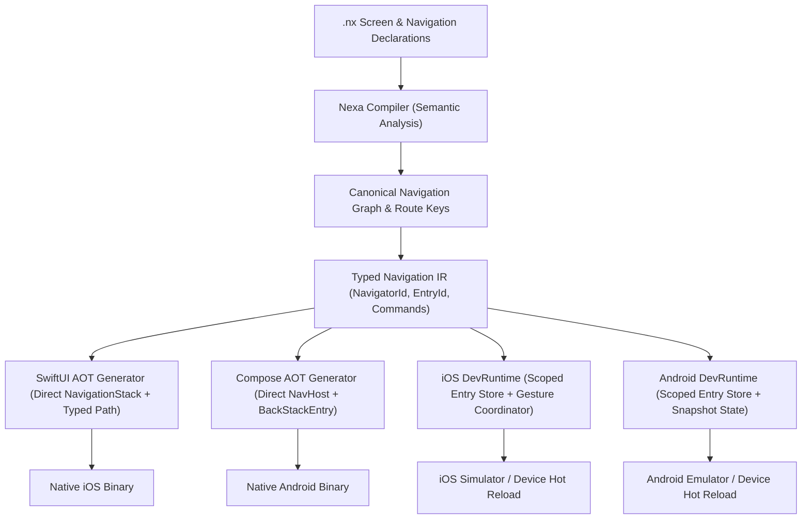

# Nexa Navigation v2 Architecture Specification

| **Status**: Accepted RFC | **Scope**: Cross-platform Navigation, State & Parity | **Targets**: iOS (SwiftUI) & Android (Jetpack Compose) |
|---|---|---|

---

## 1. Executive Summary

Nexa Navigation v2 replaces the alpha navigation engine with a formally verified, typed cross-platform navigation architecture. It guarantees **100% behavioral and visual parity** between Ahead-Of-Time (AOT) compiled binaries and the hot-reload DevRuntime on both iOS and Android.

Production release builds remain **direct, idiomatic native SwiftUI (`NavigationStack`) and Jetpack Compose (`NavHost`)** with **zero runtime reflection, zero `AnyView` type erasure, zero dynamic string route lookups on hot paths, and zero primitive state boxing**.



---

## 2. Core Deficiencies Resolved (NAV-01 to NAV-10)

| ID | Defect in Navigation v1 | Resolution in Navigation v2 |
|---|---|---|
| **NAV-01** | Screen state was keyed by `screen/<name>` in DevRuntime, causing duplicate pushes of the same screen to corrupt each other's state. | **Entry-owned state scopes**: state is keyed by `entry/<entryId>/state/<name>`. Each push instance owns distinct mutable state. |
| **NAV-02** | Stack selection used ambiguous fallback (e.g. `navigationPaths.keys.first` or `currentNavController`), causing pushes from detached tasks, tabs, or callbacks to navigate the wrong stack. | **Explicit NavigatorId**: Every command carries an authoritative `NavigatorId` captured at origin. No global/heuristic fallback. |
| **NAV-03** | Route payloads and tokens in iOS Dev were hashed or stored in auxiliary growing maps without authoritative entry identities. | **Authoritative EntryId**: Allocated at push time; payload is stored on the entry and passed directly into view rendering and lifecycle hooks. |
| **NAV-04** | Android DevRuntime reset the entire `NavHost` on any screen inventory edit or locale change via `key(navigationEpoch)`. | **Deterministic Graph Reconciliation**: Graph-compatible updates preserve active back stack entries and their state. |
| **NAV-05** | Deep links had conflicting platform semantics: iOS cleared the stack before appending, while Android pushed on top of the existing stack. | **Canonical Deep Link Policy**: Uniform, versioned URL routing rules with explicit cold-start and warm-intent stack replacement/parent-chain semantics. |
| **NAV-06** | iOS Dev back gestures had duplicate, conflicting layers (`simultaneousGesture(DragGesture)` + UIKit `interactivePopGestureRecognizer` delegate). | **Single Native Gesture Coordinator**: One coordinated UIKit pop recognizer delegate handling custom navigation bars, RTL, and swipe cancellation. |
| **NAV-07** | Screen lifecycle (`onAppear`/`onDisappear`) was name-scoped rather than entry-scoped. | **Entry-scoped Lifecycle**: Foreground, visible, covered, and destroyed events are tied to specific `EntryId` lifecycles. |
| **NAV-08** | No common navigation command model in IR (IR had only basic `NavigationPush` and `NavigationBack`). | **Canonical Navigation Commands**: Strongly-typed `Push`, `Pop`, `PopTo`, `ReplaceTop`, `Reset`, `SelectTab`, and `OpenExternalRoute`. |
| **NAV-09** | Host model and tabs were implicitly coupled with ad-hoc bottom bar emitter chrome logic. | **Explicit Navigator Scopes**: Navigators are declared per app root, tab root, or modal container with defined hierarchy. |
| **NAV-10** | Parity test suite only tested a basic 4-step happy path. | **16 Deterministic Differential Scenarios (NAV-T01 to NAV-T16)** with canonical snapshot verification. |

---

## 3. Data Model & Types

### 3.1 Identifiers

- **`NavigatorId`**: Deterministic identifier for a navigation container.
  - App root stack: `NavigatorId("app/root")`
  - Tab stack: `NavigatorId("tab/<index>")` (e.g. `NavigatorId("tab/0")`)
  - Modal container: `NavigatorId("modal/<id>")`
- **`RouteKey`**: Stable compile-time identifier for a screen declaration (e.g. `RouteKey("Details")`, `RouteKey("Settings")`), independent of file order or internal `ScreenId` index.
- **`EntryId`**: Monotonically increasing or UUID-based unique instance identifier allocated when a route is pushed onto a stack.

### 3.2 Canonical Navigation Snapshot Schema

```json
{
  "$schema": "https://nexa.dev/schemas/navigation-snapshot-v2.json",
  "graphVersion": 2,
  "activeNavigator": "tab/0",
  "navigators": {
    "tab/0": {
      "id": "tab/0",
      "rootRoute": "Home",
      "entries": [
        {
          "entryId": "entry_001",
          "route": "Home",
          "payload": {}
        },
        {
          "entryId": "entry_002",
          "route": "Details",
          "payload": { "id": 42, "source": "featured" }
        }
      ]
    },
    "tab/1": {
      "id": "tab/1",
      "rootRoute": "Library",
      "entries": [
        {
          "entryId": "entry_003",
          "route": "Library",
          "payload": {}
        }
      ]
    }
  },
  "presentedModals": []
}
```

---

## 4. Canonical Navigation Commands

All navigation operations execute via atomic commands dispatched to the navigation reducer:

```rust
pub enum NavigationCommand {
    /// Pushes a new route instance onto the specified navigator stack.
    Push {
        navigator: NavigatorId,
        route: RouteKey,
        payload: TypedRoutePayload,
    },
    /// Pops the top entry from the specified navigator stack.
    Pop {
        navigator: NavigatorId,
    },
    /// Pops back to a specific existing entry in the stack.
    PopTo {
        navigator: NavigatorId,
        entry: EntryId,
        inclusive: bool,
    },
    /// Atomically replaces the top entry on the stack.
    ReplaceTop {
        navigator: NavigatorId,
        route: RouteKey,
        payload: TypedRoutePayload,
    },
    /// Resets the stack to a single root entry.
    Reset {
        navigator: NavigatorId,
        root: NavigationEntry,
    },
    /// Switches the active tab navigator.
    SelectTab {
        navigator: NavigatorId,
    },
    /// Dispatches an external inbound deep-link URI.
    OpenExternalRoute {
        uri: String,
    },
}
```

### Reducer Invariants:
1. **Push**: Increases the target stack depth by exactly 1. Generates a fresh, unique `EntryId`. Leaves all other stacks untouched.
2. **Pop**: Decreases target stack depth by 1 if depth > 1. Never removes the root entry.
3. **PopTo**: If `entry` exists in the target stack, pops all entries above it (and `entry` itself if `inclusive = true`). If `entry` is not found, it is a no-op with a diagnostic warning.
4. **ReplaceTop**: Replaces the last entry with a newly allocated `EntryId` and payload. Stack depth remains unchanged.
5. **Reset**: Discards all entries in the target stack and installs the designated root entry.
6. **State Destruction**: When an entry is popped/discarded, its entry-scoped state (`entry/<entryId>/*`) and active lifecycle subscriptions are disposed immediately.

---

## 5. Platform Code Generation & Native Adapters

### 5.1 Swift / SwiftUI AOT (`nexa-backend-swift`)

In release builds, the Swift backend generates zero-overhead, statically-typed SwiftUI navigation code:

- Statically typed enum `AppRoute: Hashable, Identifiable` containing all screen variants and typed associated values.
- Each route item in `[AppRoute]` carries an internal `EntryId` (UUID or sequential token).
- Standard SwiftUI `NavigationStack(path: $coordinator.path)` observing an `@Observable` or `@StateObject` `NexaNavigationCoordinator`.
- Destinations are resolved compile-time via `.navigationDestination(for: AppRoute.self)` without `AnyView`.
- Integrated `NexaNavigationBackSwipeModifier` hooks UIKit `interactivePopGestureRecognizer.delegate` without conflicting drag gestures.

### 5.2 Kotlin / Jetpack Compose AOT (`nexa-backend-kotlin`)

In release builds, the Kotlin backend generates idiomatic Jetpack Compose navigation:

- Strongly-typed destination routes with typed arguments serialized through safe bundle arguments.
- `NavHost(navController = coordinator.navController, startDestination = ...)` with defined native transition animations.
- Screen state ViewModels are bound to the `NavBackStackEntry.viewModelStore`, naturally tying state lifetime to the back stack entry.
- `BackHandler(enabled = coordinator.canPop)` observing Compose snapshot state to guarantee instant, reactive back-button handling.

### 5.3 DevRuntime (iOS & Android)

In development hot-reload mode:

- `NexaDevState` manages entries dynamically using `EntryId`.
- Screen state is allocated on-demand per `EntryId`.
- Hot-reload diffs update components and functions without resetting the active back stack when the route graph remains compatible.
- Both iOS (`NexaDevRenderer.swift`) and Android (`NexaDevNavigation.kt`) execute identical reducer logic for all commands.

---

## 6. Deep Links & State Restoration

1. **URL Schema**:
   - Scheme format: `<app-scheme>://<screen-name>?<arg1>=<val1>&<arg2>=<val2>`
2. **Delivery Semantics**:
   - **Cold launch**: App launches with root screen and pushes the parsed destination route.
   - **Warm launch (`newIntent` / `onOpenURL`)**: Dispatches `OpenExternalRoute`. If already on the screen with identical arguments, does not duplicate. Otherwise pushes the destination on the active tab stack.
3. **State Restoration**:
   - Navigation stacks serialize `(RouteKey, Payload)` pairs using versioned JSON payloads.

---

## 7. Migration & Compatibility

Existing `.nx` application syntax is 100% supported:

```nx
// Standard navigation components lower directly into Navigation v2 commands
NavigationStack(root: HomeScreen)
NavigationLink(destination: DetailScreen(id: item.id))
NavigationBack(label: "Back")
```

No breaking changes to `.nx` syntax are required. Deprecated patterns (like untyped global pushes) emit compiler warnings with automated suggestions.
